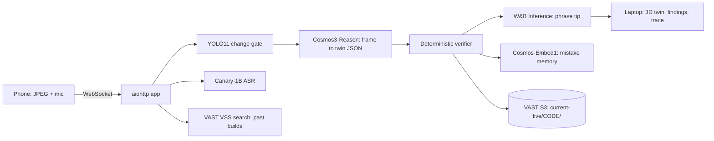

# CURRENT — a proactive, verified electronics teacher

VAST Builders Challenge submission. Point a phone camera at a breadboard; CURRENT watches, builds a live 3D digital twin of your circuit, deterministically verifies it, and speaks up *before* you power it on wrong.

**Why not just Gemini Live?** Gemini Live answers when asked and trusts its own eyes. CURRENT is (1) always-on and proactive: it teaches step by step and interrupts on mistakes; (2) deterministic: every spoken tip is gated by a verifier (MNA circuit solve + rules + optional Z3), so the LLM only phrases verified facts; (3) a 3D twin (three.js) that highlights the next pin to use.

## Architecture

## Sponsor tools

| Tool | Used for | Code |
|---|---|---|
| NVIDIA Cosmos3-Reason | frame to twin JSON, diagnosis | `app/perception/cosmos.py` |
| NVIDIA YOLO11 | change trigger / scene gate | `app/perception/yolo.py`, `worker.py` |
| NVIDIA Canary-1B | hold-to-talk ASR | `app/audio/canary.py` |
| NVIDIA Cosmos-Embed1 | "have I made this mistake before?" cosine recall | `app/sponsors/embed_memory.py` |
| CoreWeave GPUs | host all NVIDIA endpoints | `app/config.py` URLs |
| W&B Inference | LLM phrasing of verified guidance | `app/coach.py` |
| VAST S3 | twin snapshots, key frames, session summary | `app/sponsors/vast_store.py` |
| VAST VSS / DB | search over indexed past builds | `app/history.py` |
| Cursor | coding agent that built the app | whole repo |

Live status of each: `GET /api/sponsors` (`app/sponsors/registry.py`). Details: `docs/SPONSORS.md`.

## Run

`bash deploy.sh`, then open https://workshop.thecosmoslabs.com and click **App**. Open the same session on a laptop (twin view) and phone (camera + mic). Missing sponsor credentials never crash the app; that feature reports `disabled`.

**Inputs:** camera JPEG about 1 Hz, mic WAV, typed questions. **Outputs:** twin graph, verifier findings, spoken/text guidance, trace panel.

## Evaluate (Blink script)

1. Say or click **Blink**. 2. Place the LED backwards (cathode to D13) — expect a polarity finding. 3. Omit the 220 ohm resistor — expect a missing-resistor finding. 4. Repeat the polarity mistake — expect the "you made this mistake before" recall. 5. Fix: D13 to 220 ohm to LED anode, cathode to GND — verifier passes. 6. Open the trace panel to see each sponsor call with latency, and check `current-live/<code>/` in the VAST S3 bucket.

## Stack

aiohttp + WebSocket (one small server, no build step), three.js for the twin, MNA/Z3 verifier in plain Python, boto3 for S3. No vendored dependencies; the bundle is under 1 MiB.

## Merged from teammate branch `integration`

Credit to the `integration` branch (FastAPI polling app) for: the VSS "learn from past builds"
few-shot idea (ported as `app/history.py::grounding_examples`, used in the coach's step tip
prompt, traced as a `sponsor=vast` span, fails soft) and the camera picker that prefers
Desk View / Continuity Camera (ported as `frontend/camera.js`, `CurrentCamera.populate(select, onPick)`).
Its caption-regex `rules.py` checks (no resistor, 5V-GND short, rewiring with USB, wrong pin) are
already covered by the twin-based detectors in `app/mistakes.py`, so they were not duplicated.
